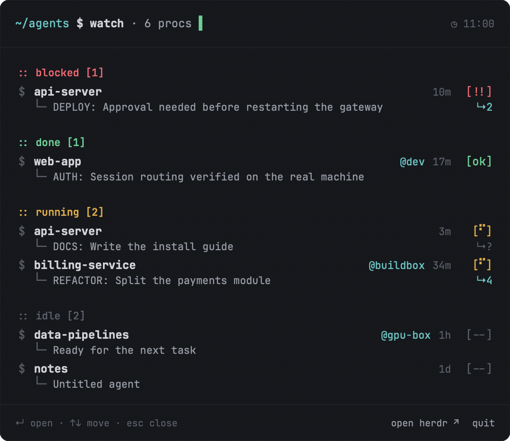
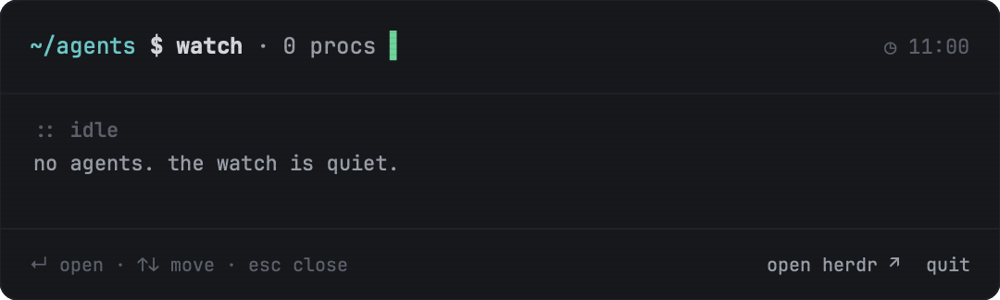

# HerdrBar

A macOS menu bar app for [Herdr](https://herdr.dev) agents. It shows the agents Herdr is running, local or on a remote machine, in a panel styled like Herdr's `~/agents $ watch` sidebar. Click an agent and Herdr opens that session.



The menu bar item shows a braille spinner while agents work, `!N` with a pulsing alert glyph when any agent is blocked, and `✓N` when agents finished while you weren't looking. When Herdr isn't running the glyph dims.

The panel groups agents by what they need from you, in this order: blocked, done, running, idle. Each row shows the space, the machine for remote agents, how long the agent has been in that state, and its current task. Rows slide in when the panel opens and flash when an agent changes state. The panel respects the system "Reduce motion" setting.



## Requirements

- macOS 14 or later.
- [Herdr.app](https://herdr.dev) with its CLIs installed: `hc` (also shipped as `herdr-core`) and `herdr-app`.

## Install

Build from source. There is no binary release yet.

```sh
git clone https://github.com/jrecos/HerdrBar.git
cd HerdrBar
./Scripts/package_app.sh
mv HerdrBar.app /Applications/
open /Applications/HerdrBar.app
```

The script signs the app ad hoc. Set `APP_IDENTITY="Developer ID Application: ..."` to sign with your own certificate.

Right-click the menu bar item for "Launch at Login", "Open Herdr" and "Quit HerdrBar".

## Keys

With the panel open:

| Key | Action |
| --- | --- |
| ↑ / ↓ | Move the selection |
| ↵ | Open the selected agent in Herdr |
| esc | Close the panel |

Clicking outside the panel also closes it.

## How it reads Herdr

HerdrBar runs Herdr's own CLIs. Every call is read-only except the one that focuses an agent.

| Command | Purpose |
| --- | --- |
| `hc ls --json` | The terminals Herdr core knows about |
| `hc get --json <address>` | One terminal's state, turn, labels and title |
| `herdr-app ls` | Space names |
| `hc --version`, `herdr-app --version` | Confirms a candidate binary before each refresh |
| `herdr-app do agent.focus '{"terminal":"<address>"}'` | Open the agent you clicked (after activating Herdr.app) |

It refreshes every 5 seconds, or every 2 seconds while the panel is open. Each call runs off the main thread with a 3 second timeout.

An agent is a terminal whose program reports a status. Sub-agents started with `hc run` are left out; Herdr shows them under their parent. A terminal that core reports as `idle` or `done` counts as done only when its `turn` is newer than the `herdr.seen` label, which is how Herdr itself decides whether you have looked at it. An `error` status shows as blocked.

GUI apps don't inherit your shell `PATH`, so HerdrBar looks for the CLIs in this order: the paths in its own settings, `PATH`, then `~/.local/bin`, `/opt/homebrew/bin` and `/usr/local/bin`. A candidate for `hc` must answer `--version` with a line starting `hc `, which is the check Herdr.app uses. To point HerdrBar at a CLI somewhere else:

```sh
defaults write io.github.jrecos.herdrbar hcPath /path/to/hc
defaults write io.github.jrecos.herdrbar herdrAppPath /path/to/herdr-app
```

## Privacy

HerdrBar is local only. It makes no network calls, collects no telemetry, and stores nothing except the two optional CLI paths above in its own defaults domain.

## Development

```sh
swift build
swift test
./Scripts/compile_and_run.sh      # build, package, relaunch
./Scripts/compile_and_run.sh --test
```

The package has two targets. `HerdrBarCore` holds the models, the CLI client and its JSON parsing, the attention rules and the formatting, with no AppKit dependency. `HerdrBar` is the app: status item, panel, animations and the right-click menu. `Tests/HerdrBarCoreTests` runs the core against JSON fixtures modelled on real CLI output.

To render the panel without a screen, which is how the screenshots above were made:

```sh
HerdrBar.app/Contents/MacOS/HerdrBar --snapshot out.png --fixture docs/fixtures/mixed.json
HerdrBar.app/Contents/MacOS/HerdrBar --snapshot out.png     # live data
```

The panel uses "JetBrainsMono Nerd Font" (or "JetBrainsMonoNL Nerd Font") when it is installed, otherwise the system monospace font.

See [AGENTS.md](AGENTS.md) for the layout and conventions.

## License

MIT. See [LICENSE](LICENSE).

Inspired by [CodexBar](https://github.com/steipete/CodexBar) by Peter Steinberger.
